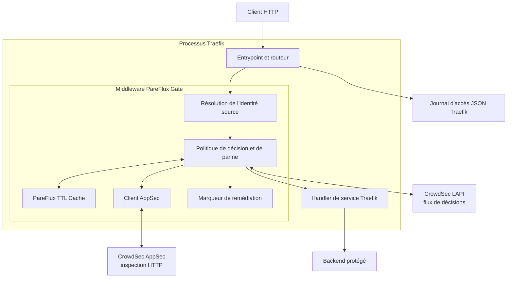
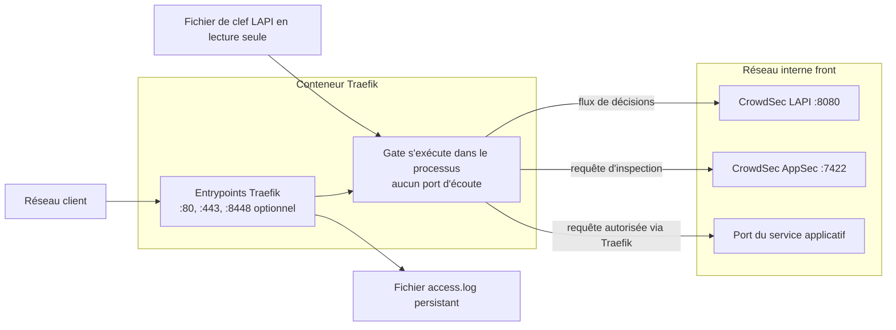
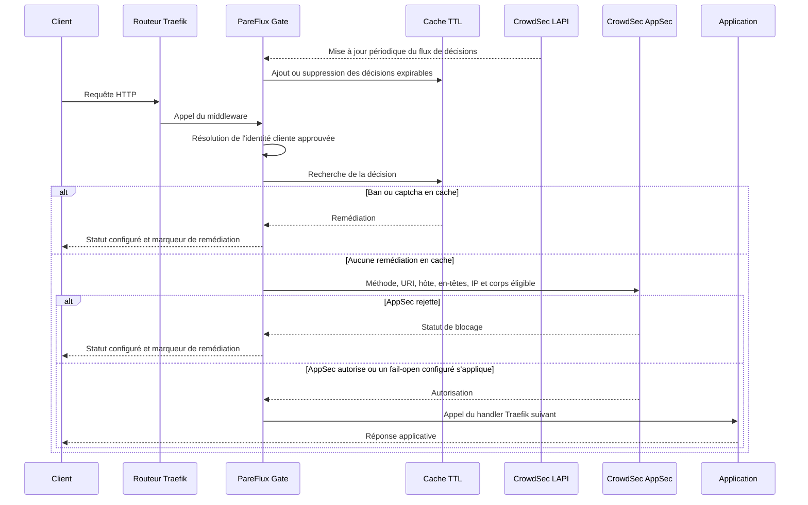
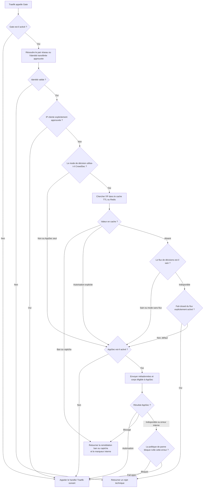

# PareFlux Traefik Gate

Documentation : [English](README.md) | **Français**

PareFlux Gate est un middleware HTTP Traefik sous Apache-2.0 pour les décisions
CrowdSec, CrowdSec AppSec et la mise en cache rapide des décisions.

Il dérive de `maxlerebourg/crowdsec-bouncer-traefik-plugin` v1.6.0 sans
importer son historique Git ni sa dépendance de cache GPL-3.0. La provenance
est décrite dans `UPSTREAM.md`.

## Chemin de décision

1. Résoudre l'adresse du pair réseau ou une identité transférée explicitement
   approuvée.
2. Lire le cache TTL éphémère PareFlux.
3. Interroger ou suivre les décisions CrowdSec LAPI.
4. Soumettre les requêtes HTTP éligibles à CrowdSec AppSec.
5. Retourner la remédiation configurée ou appeler le handler suivant.

Les décisions persistantes restent sous l'autorité de CrowdSec LAPI. Le cache
local est vidé au redémarrage de Traefik.

Pour les adresses sans décision en cache, le cache de flux fonctionne en mode
fermé lorsque LAPI est temporairement inaccessible. Définir
`crowdsecStreamUnreachableBlock: false` uniquement si une politique privilégiant
explicitement la disponibilité est requise. Les bans déjà en cache restent
appliqués dans les deux modes.

Gate utilise par défaut l'adresse réseau du pair. Il ne consulte
`X-Forwarded-For` que si le pair immédiat appartient à
`forwardedHeadersTrustedIps` ; les chaînes transmises mal formées sont rejetées.

`remediationHeadersCustomName` est écrit dans la réponse de rejet et dans les
en-têtes de requête préalablement assainis en interne. Conserver cet en-tête
dans le journal d'accès Traefik permet à CrowdSec d'ignorer les rejets produits
par PareFlux au lieu de les réinjecter dans les scénarios de sondage HTTP.

AppSec continue de contrôler les métadonnées des requêtes gRPC et WebSocket,
mais ne précharge pas leurs corps diffusés en continu.

## Intégration avec Traefik

Gate est un plugin local Traefik, pas un proxy inverse ni un sidecar. Traefik
charge le code Go avec Yaegi et appelle le middleware dans son propre pipeline
HTTP. Le plugin partage donc le processus et les objets de requête de Traefik,
mais ouvre ses propres connexions HTTP internes vers CrowdSec LAPI et AppSec.

Le projet installe le code du plugin en lecture seule, monte sa clef LAPI depuis
un fichier secret en lecture seule et référence le middleware depuis les
routeurs ou entrypoints protégés. Une panne de Gate ne doit jamais nécessiter
un accès direct au socket Docker ni au réseau hôte.

### Architecture



### Flux réseau



Le client ne se connecte jamais directement à Gate, LAPI ou AppSec. Le seul
listener public est un entrypoint Traefik. Les plages d'en-têtes transférés de
confiance déterminent quand Gate peut tirer l'identité cliente d'un en-tête de
proxy plutôt que du pair réseau.

### Flux applicatif



### Flux de décision de ban



Les bans en cache restent appliqués pendant une panne LAPI. Lors d'un défaut de
cache, la politique de flux est fermée par défaut ;
`crowdsecStreamUnreachableBlock: false` active explicitement le mode ouvert. Les
politiques d'indisponibilité et d'erreur interne AppSec se configurent
indépendamment.

## Vérification

```bash
go test -race ./...
go test -bench=. -benchmem ./...
go mod vendor
```

Chaque version doit aussi être chargée comme plugin local dans l'image Traefik
épinglée et réussir les benchmarks de requêtes de bout en bout.

## Dépôts et versions publiques

PareFlux est maintenu par un auteur français qui souhaite disposer d'une
documentation complète et de premier niveau en français. Une version anglaise
complète est maintenue en parallèle, car l'anglais est la langue internationale
de fait pour la collaboration technique et l'écosystème Traefik.

Le [dépôt GitLab](https://github.com/vandman/pareflux-traefik-gate)
est le dépôt de développement principal et contient les commits intermédiaires
et les versions de développement. Le [dépôt GitHub](https://github.com/vandman/pareflux-traefik-gate)
est le canal public de distribution et de contribution, car le catalogue de
plugins Traefik accepte uniquement les dépôts GitHub publics.

Seuls des instantanés stables sont promus vers GitHub. Un tag GitLab protégé
nommé `publish/vX.Y.Z` crée un unique commit public et le tag GitHub immuable
`vX.Y.Z`. Les issues et pull requests publiques sont les bienvenues ; leur
parcours d'intégration est décrit dans
[CONTRIBUTING.FR.md](CONTRIBUTING.FR.md).

## Licence

Apache-2.0. Les dépendances GPL-3.0, AGPL et de licence inconnue sont refusées.
