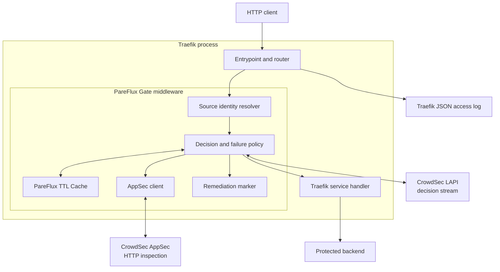
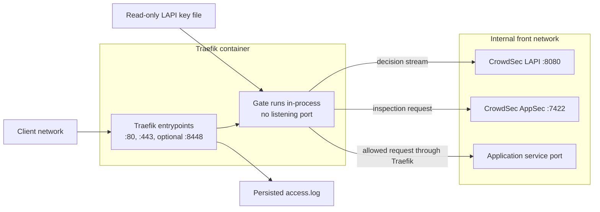
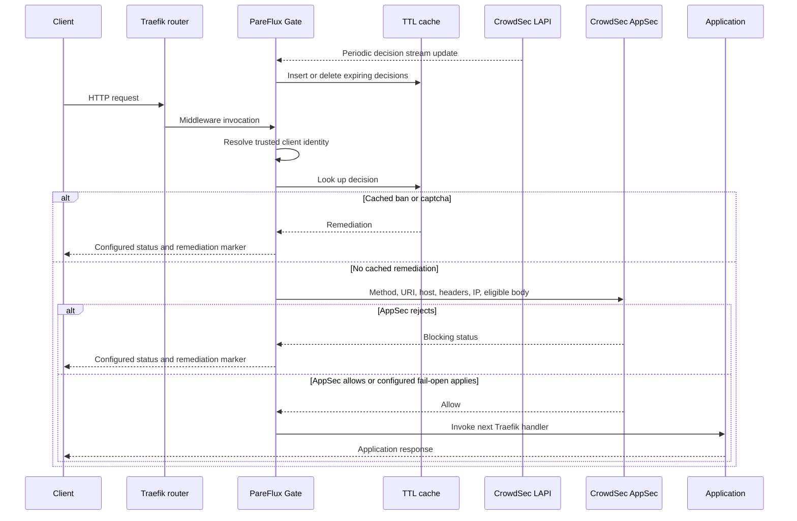
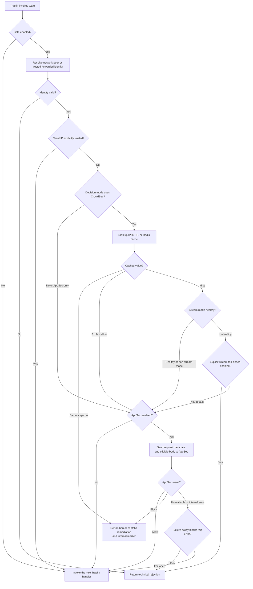

# PareFlux Traefik Gate

PareFlux Gate is an Apache-2.0 Traefik HTTP middleware for CrowdSec decisions,
CrowdSec AppSec, and fast in-process decision caching.

It is derived from
`maxlerebourg/crowdsec-bouncer-traefik-plugin` v1.6.0 without importing its Git
history or GPL-3.0 TTL cache dependency. Provenance is recorded in
`UPSTREAM.md`.

## Decision flow

1. Resolve the network peer or an explicitly trusted forwarded identity.
2. Read the ephemeral PareFlux TTL cache.
3. Query or stream decisions from CrowdSec LAPI.
4. Submit eligible HTTP requests to CrowdSec AppSec.
5. Return the configured remediation or forward to the next handler.

Persistent decisions remain owned by CrowdSec LAPI. The local cache is emptied
when Traefik restarts.

The stream cache fails closed for addresses without a cached decision when LAPI
is temporarily unreachable. Set `crowdsecStreamUnreachableBlock: false` only
when an explicit availability-first policy is required. Existing cached bans
remain enforced in both modes.

Gate uses the network peer address by default. It consults
`X-Forwarded-For` only when the immediate peer belongs to
`forwardedHeadersTrustedIps`; malformed forwarded chains are rejected.

`remediationHeadersCustomName` is written to both the rejection response and
the internally sanitized request headers. Keeping this header in the Traefik
access log lets CrowdSec discard rejections produced by PareFlux itself instead
of feeding them back into HTTP probing scenarios.

AppSec still checks request metadata for gRPC and WebSocket traffic, but does
not preload their streaming bodies.

## Integration with Traefik

Gate is a Traefik local plugin, not a reverse proxy or sidecar. Traefik loads
the Go source through Yaegi and invokes the middleware inside its own HTTP
request pipeline. The plugin therefore shares Traefik's process and request
objects but opens its own internal HTTP connections to CrowdSec LAPI and AppSec.

The project installs the plugin source read-only, mounts its LAPI key as a
read-only secret file, and references the middleware from protected routers or
entrypoints. A Gate failure must never require direct access to the Docker
socket or the host network.

### Architecture



### Network flow



The client never connects to Gate, LAPI, or AppSec directly. The only public
listener is a Traefik entrypoint. The trusted forwarded-header ranges determine
when Gate may derive a client identity from a proxy header instead of the
network peer.

### Application flow



### Ban decision flow



Cached bans remain effective during a LAPI outage. On a cache miss the stream
policy fails closed by default; `crowdsecStreamUnreachableBlock: false` is the
explicit fail-open switch. AppSec availability and internal-error policies are
configured independently.

## Verification

```bash
go test -race ./...
go test -bench=. -benchmem ./...
go mod vendor
```

Every release must also load successfully as a local plugin in the pinned
Traefik image and pass end-to-end request benchmarks.

## Repositories and public releases

GitLab is the primary development repository and contains intermediate commits
and development releases. GitHub is the public distribution and contribution
channel because the Traefik Plugin Catalog only accepts public GitHub
repositories.

Only stable snapshots are promoted to GitHub. A protected GitLab tag named
`publish/vX.Y.Z` creates one public commit and the immutable `vX.Y.Z` GitHub
tag. Public issues and pull requests are welcome; see
[CONTRIBUTING.md](CONTRIBUTING.md) for their integration path.

## License

Apache-2.0. GPL-3.0, AGPL, and unknown-license dependencies are rejected.
