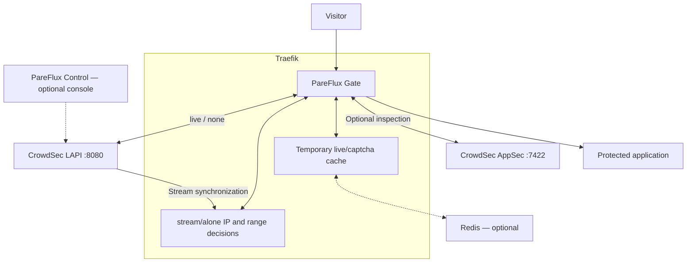

<!-- FR: Décrit les composants actuels de protection. EN: Describes current protection components. Called by: installation guide; Calls: runtime reference. -->
# PareFlux Gate architecture

[Installation](../README.md) · [Français](architecture.FR.md)

Gate runs inside Traefik. CrowdSec is a separate, required service: its local
API (LAPI) supplies blocking instructions. CrowdSec AppSec optionally examines
requests. The PareFlux Control console is optional and does not relay protection
calls.

## Components and connections

`alone` fills the same decision store from the CrowdSec Central API rather than
LAPI. It requires credentials and feed access and does not contain local bans.
Traefik must reach LAPI, AppSec and optional Redis over a private network; do not
publish their ports on the Internet. Gate uses a dedicated key mounted read-only
inside Traefik. Gate has no separate process or listening port.

## Engines and storage

Routes with identical resolved CrowdSec engine options share an engine, its
synchronization workers and its cache. A different address, rotated key or
changed certificate creates a separate engine. Initial synchronization precedes
healthy status; releasing the last configuration context stops its workers.

The stream/alone store indexes decisions by ID and IPv4/IPv6 prefix. It never
evicts an active ban to make room. The local TTL cache or Redis holds temporary
live lookup and captcha results; it cannot remove stream bans. Persistent
decisions remain in CrowdSec’s database, not Gate. After a restart, Gate reloads
them.

## Request handling

1. Traefik calls Gate when attached to the router or entrypoint.
2. Gate uses the network peer IP; forwarded identity is accepted only from an
   explicitly trusted proxy. A client exempted by `clientTrustedIps` bypasses
   every check.
3. `stream`/`alone` look up the IP and matching ranges in their decision store.
   `live` checks its cache then LAPI on a miss; `none` queries LAPI every time.
   `appsec` does not consult IP decisions.
4. A ban takes precedence over captcha, including overlapping ranges.
   Synchronization errors follow the configured failure policy.
5. When enabled, AppSec receives metadata and the bounded body, excluding cookies
   and `Authorization`. Bodyless requests are still inspected.
6. If permitted, Traefik forwards the request to the application.

## Failures and limits

Stream polls request full snapshots: this avoids losing changes during reloads
but transfers more data than incremental updates. The default interval is
60 seconds; shorter intervals increase CrowdSec and Traefik work.

Unexpired known bans remain enforced during an outage. Unknown clients are
refused after the failure threshold and grace by default. Actual store overflow
refuses them immediately. AppSec has a separate policy; inspection timeouts do
not receive outage grace.

See [precise limits and policies](security-runtime.EN.md), the
[option reference](configuration.EN.md) and
[optional dashboard navigation](dashboard-menu.EN.md). Traefik logs can feed
CrowdSec detection after acquisition is configured; distinguish already blocked
responses using the remediation marker to avoid a detection loop.
