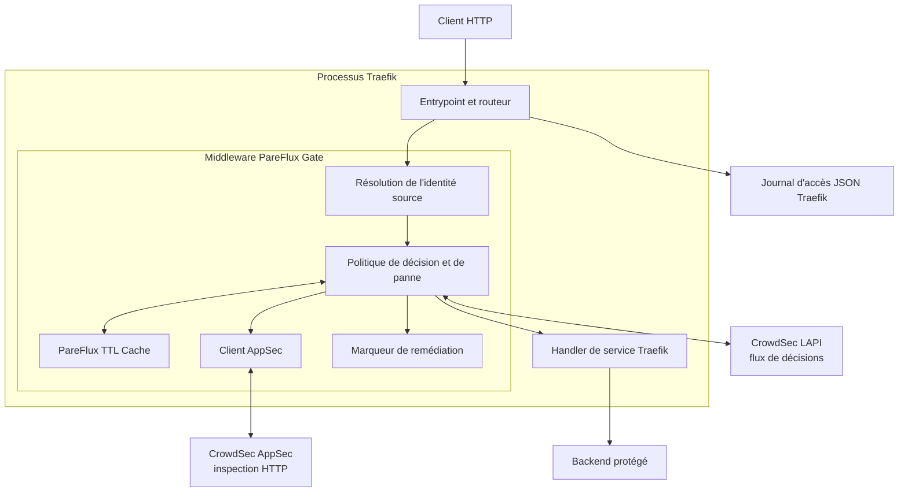
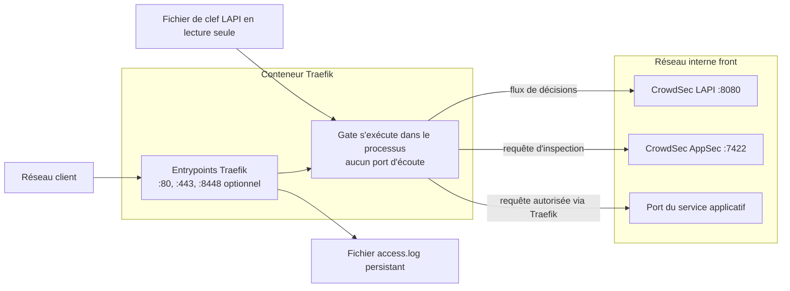
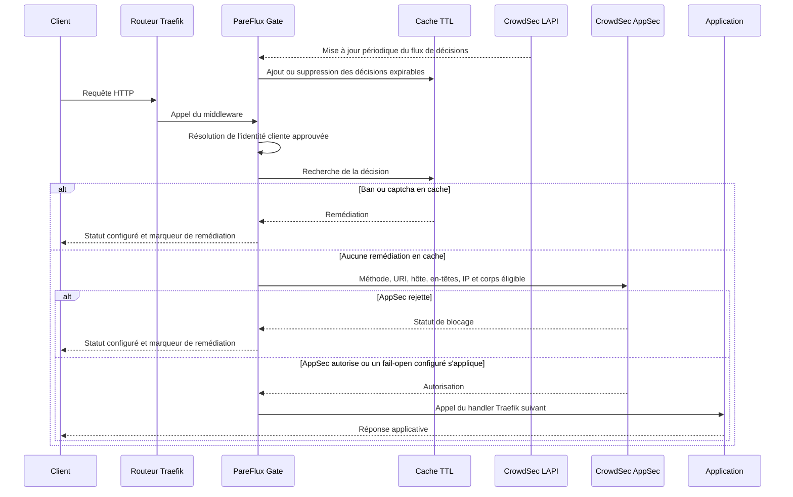
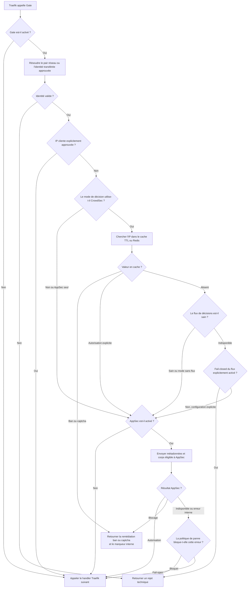

<!--
FR: Décrit les composants et décisions du middleware sans alourdir le guide d’installation.
EN: Describes middleware components and decisions separately from the installation guide.
Called by: README and LISEZMOI; Calls: Mermaid diagrams.
-->
# Architecture de PareFlux Gate

Ce document décrit le traitement des requêtes, les échanges réseau, le cache et les politiques de panne. Les schémas Mermaid sont rendus sur GitHub.

[Retour à l’installation](../LISEZMOI.md) · [English](architecture.EN.md)

## Architecture

## Flux réseau

Le client ne se connecte jamais directement à Gate, LAPI ou AppSec. Le seul
listener public est un entrypoint Traefik. Les plages d'en-têtes transférés de
confiance déterminent quand Gate peut tirer l'identité cliente d'un en-tête de
proxy plutôt que du pair réseau.

## Flux applicatif

## Flux de décision de ban

Les bans en cache restent appliqués pendant une panne LAPI. Lors d'un défaut de
cache, la politique de flux est fermée par défaut ;
`crowdsecStreamUnreachableBlock: false` active explicitement le mode ouvert. Les
politiques d'indisponibilité et d'erreur interne AppSec se configurent
indépendamment.
