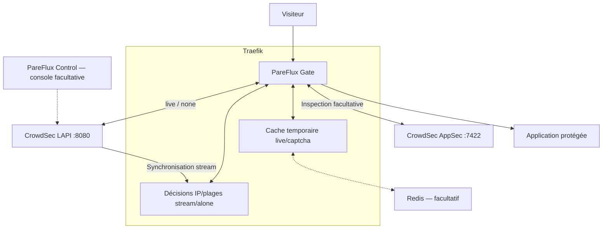

<!-- FR: Décrit les composants actuels de protection. EN: Describes current protection components. Called by: installation guide; Calls: runtime reference. -->
# Architecture de PareFlux Gate

[Installation](../LISEZMOI.md) · [English](architecture.EN.md)

Gate s’exécute dans Traefik. CrowdSec est un service distinct et nécessaire :
son API locale (LAPI) fournit les consignes de blocage. La fonction AppSec de
CrowdSec examine les requêtes en option. La console PareFlux Control reste
facultative et ne relaie pas les appels de protection.

## Composants et échanges

Le mode `alone` remplit le même magasin depuis l’API centrale CrowdSec, pas depuis
LAPI. Il exige des identifiants et un accès au flux ; il ne contient pas les
blocages locaux. LAPI, AppSec et Redis doivent être joignables par Traefik sur
un réseau privé, sans port publié sur Internet. Gate utilise une clef dédiée
montée en lecture seule dans Traefik. Gate n’a pas son propre processus ni de
port d’écoute distinct.

## Moteurs et stockage

Les routes ayant les mêmes options de moteur CrowdSec résolues partagent un
moteur, ses tâches de synchronisation et son cache. Une autre adresse, une
rotation de clef ou un changement de certificat crée un moteur distinct. Le
moteur effectue une première synchronisation avant d’annoncer un état sain ;
la libération du dernier contexte arrête ses tâches.

Le magasin stream/alone conserve les décisions par identifiant et préfixe IPv4
ou IPv6. Un blocage actif n’est pas évincé pour faire de la place. Le cache TTL
local ou Redis conserve les résultats temporaires live et captcha ; il ne peut
pas supprimer les blocages stream. Les décisions persistantes restent dans la
base CrowdSec, pas dans Gate. Après redémarrage, Gate recharge les décisions.

## Parcours d’une requête

1. Traefik appelle Gate lorsqu’il est attaché au routeur ou à l’entrypoint.
2. Gate utilise l’IP du pair réseau ; un en-tête transféré n’est accepté que
   depuis un proxy explicitement approuvé. Un client exempté par
   `clientTrustedIps` contourne tous les contrôles.
3. En `stream`/`alone`, Gate cherche l’IP et les plages correspondantes dans son
   magasin. En `live`, il consulte le cache puis LAPI si nécessaire ; `none`
   interroge LAPI à chaque requête. `appsec` ne consulte pas les décisions IP.
4. Un blocage est prioritaire sur un captcha, même avec des plages superposées.
   Les erreurs de synchronisation suivent la politique configurée.
5. Si AppSec est activé, Gate lui transmet les métadonnées et le corps limité,
   sans les cookies ni `Authorization`. Une requête sans corps reste inspectée.
6. Si les contrôles l’autorisent, Traefik transmet la requête à l’application.

## Pannes et limites

Les instantanés stream sont complets à chaque interrogation : cela évite de
perdre des changements pendant un rechargement, au prix d’un transfert plus
important que des mises à jour incrémentales. L’intervalle par défaut est de
60 secondes ; le raccourcir augmente le travail de CrowdSec et de Traefik.

Les blocages connus non expirés restent appliqués pendant une panne. Les
clients inconnus sont refusés après le seuil d’échecs et la grâce, par défaut.
Une vraie saturation du magasin les refuse immédiatement. AppSec applique sa
propre politique, sans grâce pour les expirations d’inspection.

Voir les [limites et politiques précises](security-runtime.FR.md), la
[référence des options](configuration.FR.md) et la
[navigation facultative du dashboard](dashboard-menu.FR.md). Les journaux
Traefik peuvent alimenter la détection CrowdSec après configuration d’une
acquisition ; les réponses déjà bloquées doivent être distinguées au moyen du
marqueur de remédiation pour éviter une boucle de détection.
